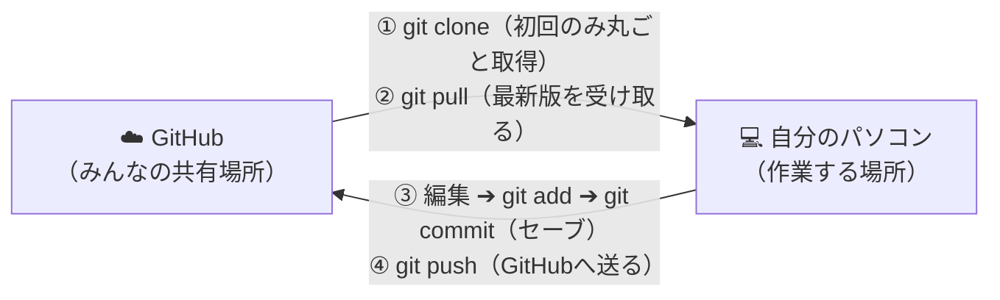

# 太鼓タイピング

音楽に合わせて流れてくる言葉を、キーボード（またはスマホのフリック入力）でタイピングして遊ぶリズム×タイピングブラウザゲームです。
インストール不要でブラウザだけで遊べて、自分で譜面（どの言葉をいつ出すかの設計図）を作ることもできます。

## このゲームでできること

- **収録されている公式譜面で遊ぶ**（難易度・制作者フィルター、並び替え、ランダム選曲に対応）
- **PCモード / スマホモードのワンタップ切替**（スマホ向けの専用フリックキーボードを搭載）
- **充実した設定＆カスタマイズ**（レーン速度変更、レーン隠し「壁」、メトロノーム付き判定オフセット調整）
- **詳細なリザルト＆弱点分析**（クリアランク、KPS計測、よくミスるノーツワースト3、ミス発生ログ一覧）
- **自分や友達が作った創作譜面ファイルで遊ぶ**
- **専用のエディタで譜面を作る**（音楽を聴きながらタイムライン上で直感的に編集）
- **インターネットランキングでスコアを競う**（Supabase連携）

---

## はじめての人向け：パソコンの準備

このゲームを自分のパソコンで動かすには、**Node.js**（ノードジェイエス）という無料のソフトが必要です。プログラムを動かすための土台になるものです。

1. [Node.jsの公式サイト](https://nodejs.org/) を開き、「LTS」と書かれた版をダウンロードしてインストールします（画面の指示に従って進めるだけでOKです）。
2. インストールできたか確認します。Windowsのスタートメニューで「PowerShell」と検索して開き、次のように入力してEnterキーを押します。

   ```powershell
   node -v
   ```

3. `v22.x.x` のような数字が表示されれば準備完了です。
   （「認識されていません」と出た場合は、パソコンを再起動してからもう一度試してください）

## 起動方法

1. このプロジェクトのフォルダをエクスプローラーで開きます。
2. フォルダの中で、上部のアドレスバー（場所が表示されている部分）に `powershell` と入力してEnterキーを押します。黒い画面（PowerShell）が開きます。
3. 開いた画面に、次のコマンドを1行ずつ入力して、それぞれEnterキーを押します。

   ```powershell
   npm install
   npm run dev
   ```

   - `npm install` … このゲームが動くのに必要な部品を集めてくる命令です。最初の1回だけでOKです。
   - `npm run dev` … ゲームを起動する命令です（同じWi-Fi内のスマホからも開きたい場合は `npm run dev -- --host` と入力します）。

4. 画面に `http://localhost:5173/` のような文字が出たら成功です。これをコピーして、Chromeなどのブラウザのアドレス欄に貼り付けて開きます。
5. ゲームを終わりたいときは、PowerShellの画面で `Ctrl` キーを押しながら `C` キーを押します。

> **「localhost」とは？**
> 「自分のパソコンの中だけで動いているページ」という意味です。インターネット上に公開されているわけではないので、自分だけがアクセスできます。

---

## サークルメンバー向け：Git入門＆開発の流れ（`git clone` から）

サークルで一緒に曲を追加したり、機能を改善したりするときは **Git（ギット）** と **GitHub（ギットハブ）** を使います。初めて触る人でも上から順番に真似するだけで開発に参加できるようまとめました。

### Git と GitHub って何？

- **Git（ギット）**：ファイルの**「セーブデータ（変更履歴）」**をパソコンに記録するツールです。「誰が・いつ・どこを書き換えたか」がすべて残り、もしプログラムを壊してしまっても、いつでも前のセーブデータに戻せます。
- **GitHub（ギットハブ）**：Gitで作ったセーブデータをインターネット上に保管して、**サークルメンバー全員で共有・合体できる場所**です。



---

### STEP 1：最初の1回だけやる準備（Gitのインストールと初期設定）

#### 1. Gitをインストールする
1. [Gitの公式サイト](https://git-scm.com/) を開き、**Download for Windows** からインストーラーをダウンロードします。
2. ダウンロードしたファイルを開き、基本的にすべて **「Next」** を押して進めればインストール完了です。
3. [GitHub](https://github.com/) のアカウントをまだ持っていない場合は作成し、サークルのリポジトリ管理者（リーダー）に自分のGitHubユーザー名を伝えてコラボレーター招待を受けてください。

#### 2. Gitに自分の名前とメールアドレスを登録する（初回のみ）
「誰がセーブ（コミット）したか」を記録するため、PowerShellを開いて以下の2行を実行します（`" "` の中を自分のものに書き換えてください）。

```powershell
git config --global user.name "あなたの名前（ニックネーム可）"
git config --global user.email "GitHubに登録したメールアドレス"
```

---

### STEP 2：プロジェクトを自分のパソコンに持ってくる（`git clone`）

GitHubにある『太鼓タイピング』のプロジェクトを、自分のパソコンに丸ごとコピー（ダウンロード）します。**この作業は最初の1回だけでOKです。**

1. Windowsのスタートメニューから **PowerShell** を開きます（またはプロジェクトを置きたいフォルダのアドレスバーに `powershell` と入力してEnterを押します）。
2. 次のコマンドを1行ずつ入力してEnterキーを押します。

```powershell
# ① GitHubからプロジェクトを丸ごとダウンロード（クローン）する
git clone https://github.com/POKKAPOKA/TAIKO-TYPING.git

# ② ダウンロードされた「TAIKO-TYPING」フォルダの中に移動する
cd TAIKO-TYPING

# ③ ゲームを動かすのに必要な部品をインストールする
npm install

# ④ ゲームを起動してブラウザで動くか確認する
npm run dev
```

> [!TIP]
> 初回以降は、`git clone` をやり直す必要はありません。2回目からはエクスプローラーで作られた `TAIKO-TYPING` フォルダを開いて作業を始めます。

---

### STEP 3：普段の開発の流れ（作業開始〜GitHubへ共有するまで）

2回目以降に「譜面を追加したい」「画面やプログラムを修正したい」ときの基本ルーティンです。

#### ①【作業前】まずは最新版を受け取る（`git pull`）
自分が作業していない間に、他のサークルメンバーが曲や機能を追加しているかもしれません。**作業を始める前には、必ず毎回 `git pull` を実行して自分のパソコンを最新状態にします。**

```powershell
git pull
```

#### ②【推奨】自分用の作業部屋（ブランチ）を作る（`git switch -c`）
いきなり全員共通の本番データ（`main`）を直接いじるのではなく、**「ブランチ（枝分かれした作業部屋）」** を作って作業すると、万が一失敗しても本番に悪影響が出ないので安全です。

```powershell
git switch -c feature/やりたいことの名前
```
- 例（新曲追加）：`git switch -c add-new-song`
- 例（バグ修正）：`git switch -c fix-score-bug`

> [!NOTE]
> サークル内で「小さい修正や譜面追加は `main` のまま直接作業してOK」と決めている場合は、この②を飛ばして③に進んで構いません。

#### ③ ゲームを起動しながら編集する（`npm run dev`）
VS Codeなどのエディタでファイルや譜面を編集し、`npm run dev` でブラウザの表示や動作を確認します。

#### ④ どのファイルを変更したか確認する（`git status`）
作業が一区切りついたら、PowerShellで以下を入力します。

```powershell
git status
```
自分が書き換えたファイルや新しく追加したファイルの一覧が表示されます。

#### ⑤ 変更をセーブデータに記録する（`git add` ＆ `git commit`）
Gitのセーブは**「箱に荷物を入れる（`add`）」➔「箱にラベルを貼って封をする（`commit`）」**の2段階で行います。

```powershell
# 1. 変更したファイルをすべて「セーブ予定の箱」に入れる（最後の「 . 」を忘れずに！）
git add .

# 2. 何を変更したか一言メモ（コミットメッセージ）をつけてセーブする
git commit -m "新曲「〇〇」の譜面を追加"
```

#### ⑥ GitHubへアップロードしてみんなに共有する（`git push`）
自分のパソコンで作ったセーブデータを、GitHubへ送信します。

```powershell
# ②でブランチを作って作業した場合
git push -u origin 自分のブランチ名

# mainブランチで直接作業した場合
git push origin main
```

> [!TIP]
> **初回 `git push` 時のログインについて**
> 初めて `git push` するときに、GitHubのログイン画面（ブラウザ認証ウィンドウ）が出ることがあります。画面の案内に従って「Authorize（承認）」を押せば完了です。

#### ⑦（ブランチを作った場合）GitHubで合体をお願いする（Pull Request）
1. ブラウザで [GitHubのリポジトリページ](https://github.com/POKKAPOKA/TAIKO-TYPING) を開きます。
2. 画面上部に黄色い帯で **「Compare & pull request」** という緑色のボタンが表示されているのでクリックします。
3. 変更内容を簡単に書いて **「Create pull request」** を押します。
4. 自分またはサークルメンバーが確認して **「Merge pull request」** を押すと、本番（`main`）に合体されます！
5. 合体が終わったら、自分のパソコンのPowerShellで `main` に戻り、最新状態を取り込んでおきましょう：
   ```powershell
   git switch main
   git pull
   ```

> **💡 ワンクリックでビルド〜プッシュまで行う便利コマンド（`main` 直接更新用）**
> このプロジェクトには、本番ビルド確認（`npm run build`）➔ `git add .` ➔ `git commit` ➔ `git push origin main` を対話式で一気に実行できるショートカットも用意されています。
> ```powershell
> npm run publish
> ```
> 実行すると `Commit message:` と聞かれるので、変更内容（例：`新曲を追加`）を入力してEnterを押すだけでGitHubへの反映まで完了します。

---

### これだけ知っていればOK！Git用語ミニ辞典

| 用語 | ひとことで言うと |
| --- | --- |
| **リポジトリ (Repository)** | プロジェクトのファイル一式と変更履歴が入っている「保管庫」のこと |
| **クローン (`git clone`)** | GitHubにある保管庫を、自分のパソコンに丸ごとコピーしてくること（初回のみ） |
| **プル (`git pull`)** | GitHubにある他のメンバーの最新変更を、自分のパソコンに取り込むこと |
| **ステージング (`git add`)** | 変更したファイルの中から「次のセーブに含めるファイル」を選ぶこと |
| **コミット (`git commit`)** | メッセージ（変更理由のメモ）を添えて、パソコン内にセーブデータを作ること |
| **プッシュ (`git push`)** | パソコン内のセーブデータをGitHubにアップロードすること |
| **ブランチ (Branch)** | 本番（`main`）に影響を与えずに作業するための「枝分かれした作業部屋」 |
| **プルリクエスト (PR)** | 「自分のブランチの作業が終わったので `main` に合体してください！」という依頼 |
| **コンフリクト (Conflict)** | 他の人と「同じファイルの同じ行」を別々に書き換えてしまい、Gitが自動で合体できず迷っている状態 |

---

### Gitで困ったときのQ&A

| 困ったこと | 原因と解決方法 |
| --- | --- |
| **`git push` したら `rejected`（エラー）と出て送れない！** | 自分が作業している間に、他のメンバーが先にGitHubを更新しています。<br>先に `git pull` を実行して最新状態を取り込んでから、もう一度 `git push` してください。 |
| **今どのブランチにいるか分からなくなった！** | `git branch` と入力すると確認できます（緑色の `*` がついているのが現在のブランチです）。<br>`main` に戻りたいときは `git switch main` と入力します。 |
| **プログラムをいじっていたら動かなくなった！最初からやり直したい！** | まだ `git commit` していない変更をすべてキャンセルして、最後のセーブ状態に戻すには次のコマンドを実行します（※書き換えた内容は消えるので注意）。<br>`git restore .` |
| **`git pull` したら `CONFLICT（コンフリクト）` と出た！** | 他のメンバーと同じ箇所を同時に編集したときに起きます。<br>VS Codeで該当ファイルを開くと「現在の変更を取り込む / 入力側の変更を取り込む」というボタンが出るので、残したい方を選んで保存し、`git add .` ➔ `git commit -m "コンフリクト解消"` ➔ `git push` します。不安なときは無理せずサークルメンバーに画面を見せて相談しましょう！ |
| **`git commit` で `-m "..."` をつけ忘れて変な画面（Vim）に入った！** | キーボードの `Esc` キーを押したあと、半角で `:q!` と打ってEnterキーを押すと脱出できます。 |

---

## 遊び方

### ホーム画面のメニュー

- **公式譜面で遊ぶ**：収録されている公式曲から選んでプレイします。
- **遊び方**：基本ルールや操作方法を確認できます。
- **PCモード / スマホモード**：タップ（クリック）するたびにモードが切り替わります。
  - **PCモード**：物理キーボードでのローマ字タイピングに最適化された画面です。
  - **スマホモード**：画面下部に**フリックキーボード**（濁点・半濁点・小文字対応）が表示され、スマホやタブレットのタッチ操作で遊べます。
- **キャラクター選択**：キャラクター選択画面を開きます（現在準備中）。
- **右上アイコン（設定 / 全画面表示）**：歯車アイコンから各種設定、全画面アイコンからフルスクリーン表示の切り替えができます。

### 公式譜面で遊ぶ（おすすめ）

1. ホーム画面の「**公式譜面で遊ぶ**」を押します。
2. 曲の一覧から遊びたい曲を選びます。
   - 難易度（☆1〜10）や譜面制作者での絞り込み、難易度・長さ・ノーツ数での並び替え（昇順/降順）が可能です。
   - 右上の「**ランダム**」ボタンを押すと、ランダムに選ばれた曲がすぐ始まります。
3. ノーツ（言葉）が左の判定枠に重なったタイミングで、その言葉の最初の文字からタイピングします。
4. プレイ中に左上のポーズボタン（または `Esc` キー）を押すと、一時停止して「リトライ」「曲選択画面に戻る」「設定変更」などができます。
5. 曲が終わるとリザルト（結果）画面が出ます。

**コツとリザルト画面の見方**

- **1文字目のタイミングが重要**：1文字目を判定枠に重なるタイミングで押すと高得点（PERFECT / GOOD）になります。2文字目以降は次のノーツが来るまでに打ち切ればOKです。
- **柔軟なローマ字入力**：複数通りの打ち方に対応しています（例：「し」は `shi` / `si` / `ci`、「つ」は `tsu` / `tu`、「ん」は `n` / `nn` / `xn` など）。
- **クリアランク（6段階）**：
  - **ALL PERFECT!!**：ミス0かつすべてPERFECT（全良）
  - **FULL COMBO!**：ミスなしで完走（フルコンボ）
  - **RANK S**：スコア 900,000点以上
  - **RANK A**：スコア 800,000点以上
  - **RANK B**：スコア 700,000点以上
  - **CLEAR**：完走
- **弱点分析**：リザルト画面では「よくミスるノーツ ワースト3」と「ミス発生ログ一覧表（発生秒数・言葉・Typoした文字や見逃し/打ち残し）」を確認でき、苦手なキーの練習に役立ちます。

---

## 設定（カスタマイズ）

ホーム画面や曲選択画面、ポーズ画面の「**設定**」から以下の項目を調整できます（設定はブラウザに自動保存されます）。

### 基本設定タブ
- **レーン速度**：ノーツが流れる速さを `1.0x` 〜 `10.0x` の範囲で調整できます（音楽のテンポや判定時間は変わりません）。
- **壁（レーン隠し）**：ノーツが流れてくる右側を `0%` 〜 `80%` 隠して、ノーツが見える範囲を狭くする上級者向け設定です。
- **創作・エディター機能の表示**：**ON (表示)** に切り替えると、ホーム画面の下部に「創作譜面を遊ぶ」「創作譜面を作る」ボタンが表示されます（初期設定はOFF）。

### サウンド＆判定タブ
- **判定オフセット**：リズム音とノーツが重なるタイミングのズレを `-` / `+`（1ms / 5ms単位）で微調整できます。
- **判定音テスト**：デモプレビューで鳴るメトロノーム音を `PERFECT音` / `GOOD音` / `MISS音` に切り替えて確認できます。

---

## 自分で譜面を作って遊ぶ

1. まず、ホーム画面右上の「**設定**」を開き、「**創作・エディター機能の表示**」を **ON (表示)** にして設定を閉じます。
2. ホーム画面下部に表示された「**創作譜面を作る**」を押すと、譜面エディタが開きます。
3. 「音源読み込み」から使いたい音楽ファイル（MP3 / WAVなど）を選びます。
4. 画面の下半分の帯（タイムライン）をクリックすると、そこにノーツが置かれます。音楽の拍に合わせて自動でピッタリの位置に吸着します。
5. 置いたノーツをダブルクリックすると、表示する言葉と読み（ひらがな）を入力できます。
6. 「SAVE AS」ボタンで譜面ファイル（`.json`）が保存されます。
7. ホーム画面の「**創作譜面を遊ぶ**」から、保存した譜面ファイル（`.json`）と音楽ファイルを読み込むと、自分の譜面でプレイできます。

### エディタの便利なショートカット

| キー | できること |
| --- | --- |
| `Space` | 音楽の再生 / 一時停止 |
| `Ctrl+Z` | 1つ前の操作を取り消す |
| `Ctrl+Y` | 取り消した操作をやり直す |
| `Ctrl+C` → `Ctrl+V` | 選んだノーツをコピー＆貼り付け |
| `Delete` | 選んだノーツを消す |
| `Ctrl+M` | 文字をまとめて連続ノーツにする（間隔指定可） |
| `Ctrl+H` | 選んだノーツの文字・読みを一括で置き換える |
| `Ctrl+L` | 歌詞をノーツにまとめて流し込む |

---

## ランキング機能を使うには（任意）

ランキングは「Supabase」（スーパベース）という無料のデータベースサービスを使って記録しています。使わなくてもゲームは遊べます。使いたい人だけ、以下を設定してください。

1. [Supabase](https://supabase.com/) で無料アカウントを作り、新しいプロジェクトを作成します。
2. Supabaseの管理画面で「SQL Editor」を開き、このプロジェクトの [supabase_setup.sql](supabase_setup.sql) の中身を貼り付けて実行します（ランキングを保存する表が作られます）。
3. 管理画面の「Project Settings」→「API」から **Project URL** と **anon public key** をコピーします。
4. このプロジェクトのフォルダに `.env.local` という名前のファイルを作り、次のように書いて保存します（[.env.example](.env.example) をコピーして書き換えると簡単です）。

   ```text
   VITE_SUPABASE_URL=コピーしたProject URL
   VITE_SUPABASE_ANON_KEY=コピーしたanon public key
   ```

5. ゲームを起動し直します（起動中なら `Ctrl+C` で止めて、もう一度 `npm run dev`）。

> **重要：`.env.local` は誰にも見せないでください**
> このファイルは「合鍵」のようなものです。Gitで共有・公開しない設定（`.gitignore`）は済んでいますが、メールやチャットに貼ったりしないよう注意してください。

設定できると、公式譜面クリア後のリザルト画面からプレイヤー名を入力してベストスコアを登録でき、曲選択画面やリザルト画面の「ランキング」ボタンから上位スコアを確認できます。

---

## うまくいかないときは

| 症状 | 試してほしいこと |
| --- | --- |
| `npm` が「認識されていません」と出る | Node.jsのインストール後にパソコンを再起動する |
| `npm install` でエラーが出る | インターネット接続を確認する。会社のネットワークなら管理者に相談する |
| `localhost:5173` が開かない | PowerShellの画面に表示されているURLを確認する（5173以外の番号の場合があります） |
| ホーム画面に「創作譜面を作る」がない | 右上の「設定」→「基本設定」から「創作・エディター機能の表示」を **ON** にする |
| 音楽や効果音が鳴らない | ブラウザのタブがミュートになっていないか確認する。画面を一度クリックしてから再生する |
| ランキングに何も表示されない | `.env.local` の設定と、SupabaseでSQLを実行済みかを確認する |

## 開発者向けメモ

<details>
<summary>譜面ファイル（score.json）の形式・公式譜面の追加方法・コマンド一覧・技術構成（クリックで開く）</summary>

### 譜面ファイルの形式

```json
{
  "bpm": 120,
  "offset": 0,
  "notes": [
    {
      "id": "note-1",
      "word": "春",
      "reading": "はる",
      "time": 1000,
      "endTime": 1500,
      "type": "normal"
    }
  ]
}
```

- `time` / `endTime` はミリ秒。`word` が画面に出る文字、`reading` がタイピング対象の読み（ひらがな）です。

### 公式譜面の追加

1. `public/songs/` の中に曲IDのフォルダを作り、譜面JSONと音源ファイルを入れます。
2. `public/songs/index.json` に次の形式で1件追加します。

   ```json
   {
     "id": "my-song",
     "title": "曲名",
     "creator": "譜面制作者",
     "difficulty": 5,
     "scorePath": "./songs/my-song/my-song.json",
     "audioPath": "./songs/my-song/my-song.mp3",
     "notesCount": 100,
     "durationMs": 60000
   }
   ```

### コマンド一覧

| コマンド | 内容 |
| --- | --- |
| `npm run dev` | 開発用サーバーを起動する（LAN公開時は `npm run dev -- --host`） |
| `npm run build` | 公開用の本番ビルドを `dist/` フォルダに出力する |
| `npm test` | Vitest によるユニットテスト（ローマ字入力パーサー等）を実行する |
| `npm run publish` | ビルド → コミット → GitHubへプッシュまで一括で行う |

### 使用技術・アーキテクチャ

- **フロントエンド**: React 19 / Vite 8
- **スタイリング**: Tailwind CSS v4 / Google Fonts (`DotGothic16`) / 和風サイバーネオンUI
- **状態管理・設計**: Zustand（`useEffect` を使わず、React 19 の `use()` フック・コールバックref・ストア購読・イベント駆動で副作用を管理する設計）
- **オーディオ**: Web Audio API（判定音・システムSEの低遅延デコード再生） / HTML5 Audio
- **バックエンド連携**: Supabase（オンラインランキング）
- **テスト**: Vitest

</details>
